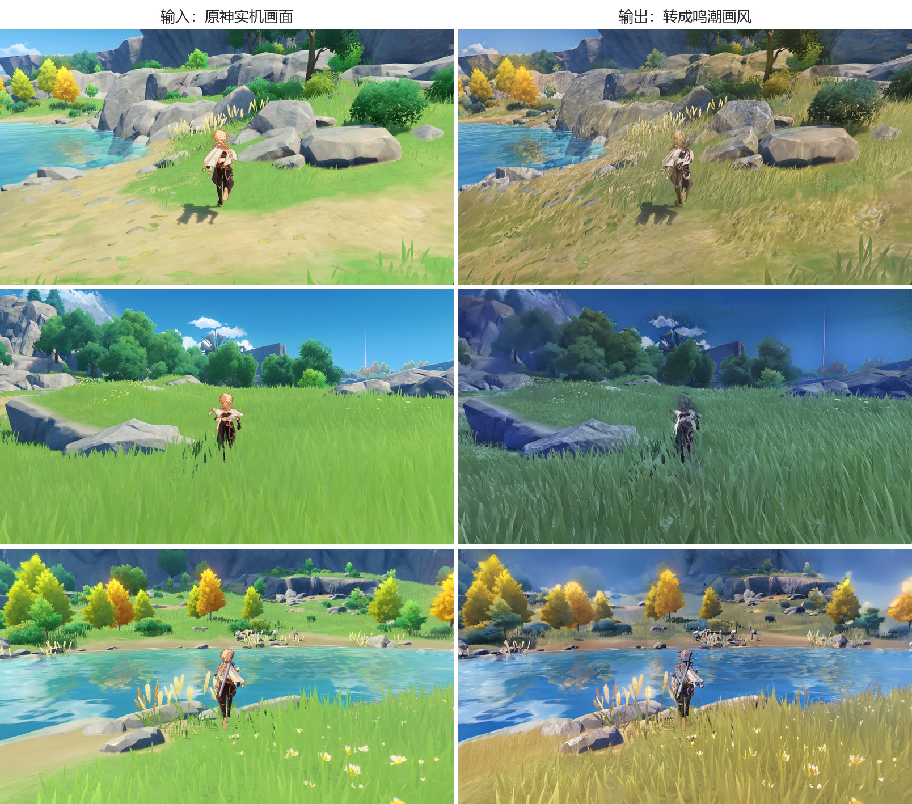
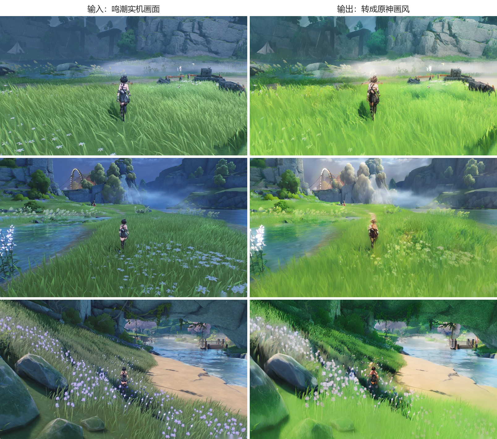
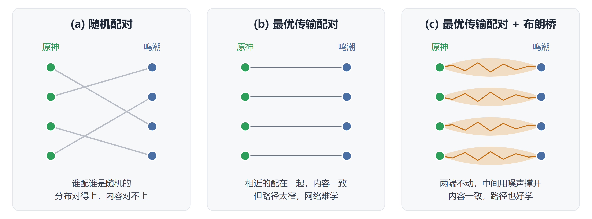
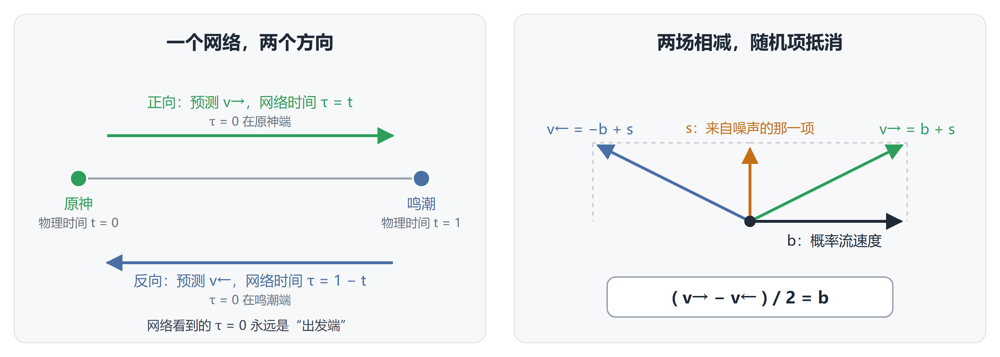
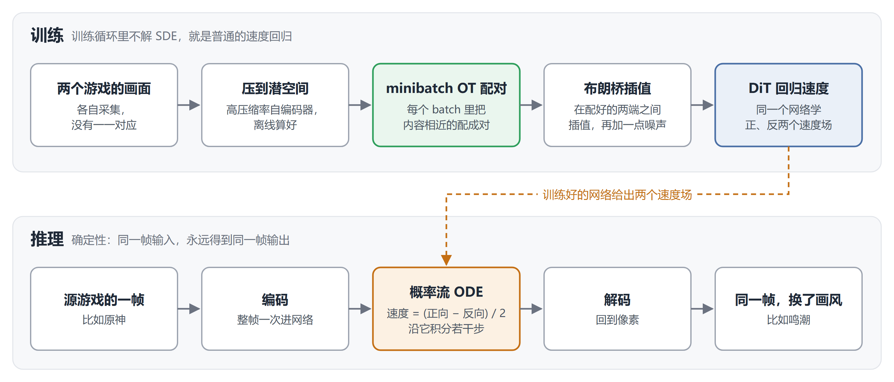
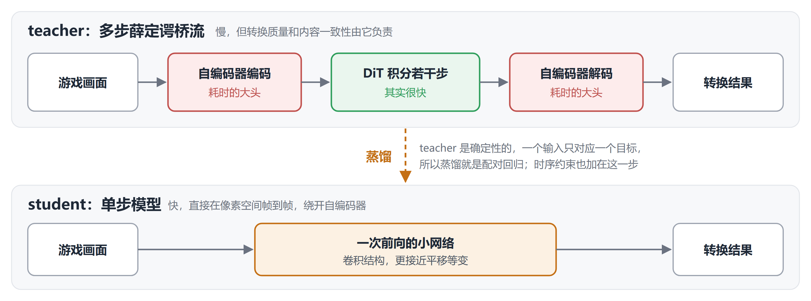

# 用薛定谔桥流做游戏画风互转：思路、原理与实现框架

> 这是一篇复现笔记。方法来自两处：DeepMind 的论文 [Schrödinger Bridge Flow for Unpaired Data Translation](https://arxiv.org/abs/2409.09347)（De Bortoli 等，NeurIPS 2024），以及知乎作者 ycz 的文章[《【生成模型】薛定谔流：玩鸣潮的同时玩原神》](https://zhuanlan.zhihu.com/p/2024965812134449840)。后者在论文基础上给出了一套训练成本低得多的做法，并展示了原神和鸣潮互转的效果。我们照着这条路线从零搭了一遍，把原文略过的部分补齐，又按自己的目标（实时转换连续的游戏画面）加了一些设计。
>
> 文中用三个标签区分来源：【论文】、【原文】（知乎文章）、【本项目】（我们补充或新增的部分）。本文只转述原文的技术要点，不复制原文内容，建议先读原文。

## 0. 写在前面

我们想做的事情：给定一帧原神的实机画面，输出"同一个场景，用鸣潮的画风来画"的结果，反过来也一样。两个游戏的画面各自采集，没有任何一一对应的配对数据。最终希望它能实时、无闪烁地处理连续的游戏画面。

先看两张目前的结果。这是早期模型的输出，细节上还有不少瑕疵，放在这里只是让读者对任务有个直观印象；输入帧都没有参与训练。





可以看到，草的画法、整体色调和光照氛围变了，而地形、树木、石头、角色的位置基本没动。这就是我们要的"只换画风，不改内容"。

本文讲的是思路、原理和实现框架，不讨论训练细节和定量结果。假设读者熟悉 flow matching、DiT、潜空间自编码器这些视频和图像生成里的常规部件，不要求了解最优传输和薛定谔桥。

## 1. 问题：什么叫"转移"

【原文】把两个游戏的画面分别看成分布 $X$ 和 $Y$，一个合格的转移 $T$ 要同时满足两件事：

1. **分布匹配**：$T_{\#}X \approx Y$，把 $X$ 的样本送进 $T$，输出的分布要像 $Y$
2. **内容一致**：$\Phi(T(x)) = \Phi(x)$，$\Phi$ 是某种"内容提取器"

满足第一条的 $T$ 有无数个。把苹果照片转成香蕉油画、把香蕉照片转成苹果油画，分布同样对得上，但显然不是我们要的。难点全在第二条，因为"内容"到底是什么很难说清：往粗了说是物体类别，往细了说连笔触都算。已有的方法在这一条上各有各的绕法：

| 方法 | 怎么处理内容一致性 | 问题 |
|---|---|---|
| 风格迁移滤镜 | 用预训练网络某几层的特征当 $\Phi$ | "内容"由特征层的选择隐式决定，没有明确定义 |
| CycleGAN | 不要 $\Phi$，改为要求转过去还能转回来 | 强行要求信息可恢复，生成器倾向于只做浅层、可逆的改动 |
| 扩散模型重绘、通用图像编辑模型 | 靠条件注入或文字指令 | 景物会被增删，结果不稳定 |

对熟悉 flow matching 的读者，可以这样理解这个问题：flow matching 并不要求起点是高斯噪声，把起点换成另一个数据分布，照样能学出一个把 $X$ 搬到 $Y$ 的流。分布匹配由流的构造保证，剩下的问题是训练时**起点和终点怎么配对**。配对方式决定了学出来的映射把谁送到谁，内容一致性就藏在这里。

## 2. 薛定谔桥：用传输代价定义"内容"

薛定谔桥的思路是不去定义内容提取器，改为规定**"内容相近"就是"搬运代价小"**。在所有能把 $X$ 搬成 $Y$ 的方案里，选总搬运代价最小的那个，也就是最优传输（OT）。代价最小的方案自然会把相近的东西配在一起。



【原文】沿着这个思路，有三种配对方式可以比较：

- **随机配对**（图 a）：标准 flow matching 的做法。分布对得上，但谁配谁是随机的，内容一致性无从谈起。
- **OT 配对**（图 b）：内容一致了，但很难学。两端都是数据分布时，插值路径只占空间里很窄的一部分，推理时稍微偏离就落到网络没见过的地方。
- **OT 配对 + 布朗桥**（图 c）：在插值路径上加噪声，两端为零、中间最大，把路径"撑开"。路径变宽，网络就好学了。

第三种就是薛定谔桥。它的插值公式只比 flow matching 多一项：

$$
x_t = (1-t)\,x_0 + t\,x_1 + \sqrt{\varepsilon\, t(1-t)}\; z, \qquad z \sim \mathcal{N}(0, I)
$$

$x_0$ 来自原神，$x_1$ 来自鸣潮。$\varepsilon$ 控制噪声强度，是整个方法最重要的旋钮：$\varepsilon$ 越大路径越宽、越好学，但离最优传输越远，画风改动更剧烈；$\varepsilon \to 0$ 时退化成 OT 配对的 flow matching。

这里有一个让整套方案成立的观察【原文】：路径已经被布朗桥撑开之后，再用 OT 配对把它往最优传输拉近，不一定会让学习变难。所以"好学"和"接近最优传输"有机会同时拿到。

**训练成本上的关键取舍。**【论文】提出的 α-DSBM 从随机配对出发，先预训练，再在线微调，微调时要用当前模型解 SDE 生成样本，靠迭代逐步逼近薛定谔桥。【原文】换了一条便宜得多的路：直接在每个 batch 里做一次 OT 配对，然后单阶段训练。训练循环里不需要解任何 SDE，和训练一个普通的 flow matching 模型差不多，原文作者报告单卡一天左右就能训完。我们采用的是这条路线。

## 3. 两个速度场与确定性推理

### 3.1 回归目标

和 flow matching 一样，用 MSE 回归速度。不同的是这里要学两个场【论文】：

$$
v^{\rightarrow}_t = \frac{x_1 - x_t}{1-t}, \qquad
v^{\leftarrow}_t = \frac{x_0 - x_t}{t}
$$

$v^{\rightarrow}$ 的含义很直白：现在在 $x_t$，还剩 $1-t$ 的时间，要走到 $x_1$ 需要多大的速度。$v^{\leftarrow}$ 是反方向的同一件事。

### 3.2 为什么要两个场

因为插值路径带噪声，单独学一个 $v^{\rightarrow}$ 得到的是一个 SDE 的漂移项。推理时必须把扩散项一起模拟，输出就带随机性。对图像生成这不是问题，对视频却很致命：每帧各采一次噪声，画面必然闪烁。

论文给出的办法是再学一个反向场。两个场各自都可以拆成"概率流速度 $b$"和"来自噪声的一项"，而且后者在两个场里完全相同：

$$
v^{\rightarrow} = b + \tfrac{\varepsilon}{2}\nabla \log p_t, \qquad
v^{\leftarrow} = -b + \tfrac{\varepsilon}{2}\nabla \log p_t
$$

两式相减，噪声项抵消：

$$
\frac{v^{\rightarrow} - v^{\leftarrow}}{2} = b
$$

于是推理时只要沿着 $b$ 解一个常微分方程 $dx = \tfrac{1}{2}(v^{\rightarrow}_t - v^{\leftarrow}_t)\,dt$，不需要采样任何噪声。【原文】把这个 ODE 称为"薛定谔流"。



确定性带来三个好处：

- **同一帧输入永远得到同一帧输出**，去掉了视频闪烁最大的来源
- **步数可以压得很低**
- **可以蒸馏**：一个输入只对应一个输出，后面做单步模型时就是普通的回归问题（第 8 节）

### 3.3 一个网络表示两个场

两个场不需要两个网络。把方向 $d$ 当作和时间一样的条件注入，一个网络 $F_\theta(x, \tau, d)$ 就能同时表示两者。

这里有一个不起眼但重要的约定【论文】：反方向时，喂给网络的时间也要反过来。正向用 $\tau = t$，反向用 $\tau = 1-t$，这样网络看到的 $\tau = 0$ 永远是"出发端"，$\tau = 1$ 永远是"到达端"（上图左）。原文提到了这个约定，没有展开原因。我们在推导重参数化系数时找到了一个解释，放在下一节。

共享网络还有一个额外的好处【原文】：推理时要把两个场相减，而两个场出自同一个网络主体，各自的系统性偏差在相减时会抵消掉不少。原文认为这是 $\varepsilon$ 较小时模型收敛很快的原因。

## 4. 重参数化：把端点的奇点管起来

从上面的公式能看出，$v^{\rightarrow}$ 在 $t \to 1$ 时分母趋于零，$v^{\leftarrow}$ 在 $t \to 0$ 时同样如此。让网络直接回归这样的目标很难训。

【论文】【原文】的办法是借用 EDM 的预条件形式：

$$
D_\theta(x_t, \tau, d) = c_{skip}(\tau)\, x_t + c_{out}(\tau)\, F_\theta\!\left(c_{in}(\tau)\, x_t,\; \tau,\; d\right)
$$

三个系数的选法和 EDM 一致：$c_{in}$ 让网络的输入保持单位方差；$c_{skip}$ 取最小二乘意义下的最优值，把能用 $x_t$ 线性解释的部分直接跳过网络；$c_{out}$ 让网络的回归目标也保持单位方差。这样无论 $\tau$ 取多少，网络面对的输入和目标都在同一个尺度上。

原文作者提到论文附录里的系数有误，但没有给出正确的推导。【本项目】的做法是从头推一遍，再用数值实验验证。完整推导在附录 A，这里只说三个要点。

**第一，和标准 EDM 相比多了一个耦合项。** 标准 EDM 里数据和噪声相互独立。这里两端都是数据，而且经过了 OT 配对，$x_0$ 和 $x_1$ 是相关的。记这个相关系数为 $\rho$，它会进入所有三个系数。做了配对却忽略它，系数就不对了。

**第二，时间反转约定的理由。** 按"反向时 $\tau = 1-t$"的约定去推反向场的系数，会发现方差、协方差这几个统计量和正向场的形式完全相同。也就是说，这个约定让两个方向可以共用同一套系数函数。这是我们对 3.3 节那个约定的解释。

**第三，实现时不用解析式，改用实测标定。** 解析式依赖一串理想假设：潜变量是零均值的，两个域方差相同，$\rho$ 已知。真实数据一条都不严格满足。更稳的做法是拿训练时真实的配对数据，在一组 $\tau$ 上直接统计出方差和协方差，做成查找表，正反两个方向各一张。它只要算一次，几乎没有成本。验证方法也简单：训练过程中监控回归目标的方差，各个 $\tau$ 上都应该接近 1。

还需要说明一点：重参数化并不能消除奇点。$c_{out}$ 在到达端仍然发散，它只是把奇点从网络的目标里分离出来单独管理。所以训练和推理时都要把 $\tau$ 截断在离端点一小段距离之外。

## 5. 内容一致性从哪来：minibatch OT 配对

前面说过，内容一致性来自配对。这一节讲配对怎么做，以及哪些细节决定了它的质量。

**在像素特征上配对，在潜空间里训练。**【原文】每个训练步，两个域各取一批样本，在低分辨率缩略图或者语义特征上算两两之间的代价，解出一个总代价最小的配对方案，再把对应的潜变量拿去训练。

**解 OT 不需要专门的库。**【本项目】两边样本数相同、权重均匀时，最优传输方案一定是一个一一对应的置换，问题就退化成经典的线性指派，用现成的求解器几毫秒就能精确解出。

**代价必须逐位置对齐。**【本项目】这是我们认为最容易被忽略的一点。布朗桥插值是逐位置进行的：左上角和左上角插值，右下角和右下角插值。如果配上的两张图只是"里面的东西差不多"，构图却对不上，比如一张的树在左边、另一张的树在右边，网络就得学"把东西挪位置"，结果就是内容漂移。所以代价要逐位置比较，不能先做全局池化再比较。

**代价函数决定"保留什么"。**【原文】用颜色空间的距离，模型倾向于学颜色相近的转移；用 DINO 这类语义特征的距离，模型倾向于在保留高层语义的前提下转移。我们自己的体会是两者各有风险：颜色距离容易让模型只学到调色；语义特征几乎不看光照，白天的画面可能被配给夜晚的画面，模型就会去学"改时间"。这个选择没有标准答案，取决于想保留哪一层的"内容"。

**在局部窗口上训练。**【本项目】我们不拿整帧去配对和训练，而是从整帧的潜变量上随机裁出窗口。原因有两个。其一，OT 只在一个 batch 内求解，候选只有一百来个；视野变小后候选之间更相似，更容易找到好的配对。其二，一帧能裁出很多个窗口，相当于扩充了数据。代价是窗口太小会丢掉天空渐变、整体光照这类全局线索，所以窗口不能太小。

把这一节和第 2 节合起来，方法暴露出四个旋钮：

| 旋钮 | 调大或换一种的效果 |
|---|---|
| 噪声强度 $\varepsilon$ | 调大：更好学，画风改动更剧烈，离最优传输更远 |
| 代价函数 | 颜色距离偏向保留颜色；语义特征偏向保留语义 |
| OT 配对的比例 | 一个 batch 里多少样本走 OT、多少保持随机。比例越高配对越"硬"，内容越一致，多样性越低 |
| 训练窗口大小 | 调小：配对更准；调大：全局画风线索更完整 |

## 6. 实现框架



### 6.1 潜空间

【原文】在像素空间训练太贵，所以整个模型工作在一个高压缩率自编码器（DC-AE，空间下采样 32 倍）的潜空间里。压缩率高，一帧画面只有几百个 token，Transformer 才跑得动。所有画面的潜变量都离线算好，训练时不再碰自编码器。

【本项目】动手之前先做一道检查：把两个游戏的画面各过一遍编码再解码，看描边、草地纹理、水面高光这些承载画风的细节有没有被压糊。如果自编码器本身就丢了画风，后面怎么训都没有意义。

### 6.2 网络

骨架是 DiT，时间 $\tau$ 和方向 $d$ 通过 AdaLN 注入【原文】。我们做了一处改动，加了一道检查【本项目】：

- **用二维的相对位置编码（RoPE）代替绝对位置编码。** 训练时网络看到的是局部窗口，推理时看到的是整帧，两者的 token 数不同。相对位置编码让网络可以直接处理不同大小的输入。它还有一个对视频有用的性质：内容按 token 网格平移时，输出基本也跟着平移，不会因为换了位置就变样。
- **训练用窗口，推理用整帧，中间加一道一致性检查。** 网络训练时没见过整幅构图，全局色调之类的判断在整帧上可能和窗口上不一样。所以要拿同一帧分别做整帧推理和逐窗口推理，比较两者的差别。差别明显时，在训练里混入一部分整帧样本。

### 6.3 训练

一个训练步的全部内容如下，和普通的 flow matching 几乎一样：

```python
z0, z1 = sample_pairs(...)             # 两域各取一批，裁窗，batch 内 OT 配对
tau = rand(B); d = rand(B) < 0.5       # 每个样本随机一个时间、一个方向
t   = where(d, tau, 1 - tau)           # 反方向时把物理时间反过来

xt  = (1-t)*z0 + t*z1 + sqrt(eps*t*(1-t)) * randn_like(z0)   # 布朗桥插值
v   = where(d, (z1 - xt)/(1-t), (z0 - xt)/t)                 # 正向或反向的目标速度

c_in, c_skip, c_out = lookup(tau, d)   # 实测标定的重参数化系数
loss = mse(net(c_in * xt, tau, d), (v - c_skip * xt) / c_out)
```

没有判别器，没有循环一致性损失，也没有 SDE 求解。

### 6.4 推理

推理就是从源图的潜变量出发，解第 3 节的 ODE：

```python
x = encode(frame)
for t in steps:                        # 原神→鸣潮：t 从 0 到 1；反过来：t 从 1 到 0，dt 为负
    v_fwd = D(x, tau=t,     d=1)       # 正向场（D 是第 4 节重参数化后的速度预测）
    v_bwd = D(x, tau=1 - t, d=0)       # 反向场
    x = x + 0.5 * (v_fwd - v_bwd) * dt
out = decode(x)
```

【本项目】有两个和视频相关的选择：

- **整帧一次前向，不切块。** 切块推理时各块看到的上下文不同，块与块之间会出现色调不一致；块的边界固定在屏幕上，内容移过边界时还会在固定位置闪烁。
- **正反两个场拼成一个 batch。** 每一步要算两个场，拼在一起只需一次前向，延迟几乎不增加。

## 7. 评估：loss 不可信之后看什么

原文没有做定量评估。我们在搭评估时发现，这类模型不能靠训练 loss 判断好坏，原因有三个【本项目】：

- 回归目标里带着布朗噪声，配对本身也是随机的，loss 里不可约的部分占大头，曲线很早就平了
- $\varepsilon$、代价函数、OT 比例都会改变训练目标本身，不同配置的 loss 没法横向比较
- 最重要的一点：内容一致性来自配对，loss 只衡量"这个配对拟合得好不好"。用随机配对训练，loss 同样可以很漂亮

所以评估要直接看转换结果。我们的做法是固定一批没参与训练的画面，定期转换出来，一边看图，一边算几类指标。指标的设计对应第 1 节的两个要素：

| 想回答的问题 | 怎么看 |
|---|---|
| 像不像目标域（分布匹配） | 输出和真实目标域画面在特征空间里的分布距离 |
| 内容有没有保留（内容一致） | 输入和输出的结构表示之间的距离，这种表示对画风不敏感 |
| 是不是只调了色 | 把输入做一次全局调色去逼近输出，看剩下的差别还有多少 |
| 是不是在背训练集 | 输出和训练集里目标域画面的最近邻相似度，是否高得不正常 |

读这些指标时有三点心得：

- **前两项是一对权衡，不存在单一的最优数字。** 什么都不改，内容保留得最好，但完全不像目标域。调 $\varepsilon$ 和 OT 比例，就是在这条权衡曲线上移动。正常的训练过程里两者应该一起变好；如果"像不像"还在改善，"内容保留"却开始变差，通常说明模型开始凭空添加内容了。
- **一定要配基线。** 至少两个：不做任何转换，以及只做全局调色。模型比全局调色好不了多少，那它实际上只学到了调色。
- **往返一致性不能说明问题。** A 转 B 再转回 A 和原图一致，看上去像是好事，但这里正反两个方向积分的是同一个 ODE，往返本来就应该回到原点。误差只反映数值积分的精度。

## 8. 时序一致性与实时化（设计思路）

这一节讲的是还没实现的部分：我们怎么分析闪烁，以及打算怎么走到实时。

### 8.1 闪烁从哪来

确定性的 ODE 去掉了随机噪声这个最大的闪烁来源，原文展示的视频在没有任何时序约束的情况下已经相当平滑。但确定性不等于连贯。记相邻两帧为 $f_k$ 和 $f_{k+1}$，$\mathcal{W}$ 表示按画面运动做对齐，把两帧输出之间的不一致拆开看：

$$
T(f_{k+1}) - \mathcal{W}[T(f_k)]
= \underbrace{T(f_{k+1}) - T(\mathcal{W}f_k)}_{\text{输入的变化被放大}}
+ \underbrace{T(\mathcal{W}f_k) - \mathcal{W}[T(f_k)]}_{\text{映射不满足平移等变}}
$$

- **第一项**：输入本身的帧间变化（抗锯齿抖动、植被摆动、遮挡）被映射放大。这和 $\varepsilon$ 有关：$\varepsilon$ 越小，映射越接近最优传输，而最优传输的映射可以很陡，在"该画成石头还是草"这类模糊地带容易来回翻。所以 $\varepsilon$ 还有一层权衡，调大一些映射会更平滑。
- **第二项**：画面平移一点，输出并不等于"原输出平移一点"。自编码器是 32 倍下采样，镜头只移动几个像素时，同一块纹理落在 token 网格里的位置变了，重建出来的细节也跟着变。表现出来就是纹理游动，在草地和树叶上最明显。

第二项可以不依赖视频直接测量：把同一帧平移若干像素，分别过一遍模型，再对齐回来比较。我们单独对自编码器做了这个测试，结论是它自己就远不满足平移等变。平移量不是整数个 token 时，两次重建之间的差别和重建误差本身是一个量级。这说明只要经过这个自编码器，输出就有一个去不掉的闪烁下限，和转换模型训练得多好无关。

### 8.2 走向实时：teacher → student



实时化的瓶颈也在自编码器上。在一张消费级显卡上，转换网络算一步只要几毫秒，而自编码器编码加解码一次要两百毫秒左右。就算把 ODE 压到一步，帧率也上不去。

这两件事指向同一个方案：把多步的薛定谔桥流当作 teacher，蒸馏出一个**绕开自编码器、直接在像素空间工作**的单步 student。

- **蒸馏很直接。** teacher 是确定性的，每个输入只对应一个输出，蒸馏就是普通的配对回归，不会因为对多种可能的输出取平均而变糊。这是第 3 节费力把 SDE 换成 ODE 的另一个回报。
- **数据不受限。** student 只需要源游戏的画面，包括连续帧，要多少有多少。
- **时序约束放在这一步。** 可以在连续帧上要求输出随画面运动保持一致，也可以在单帧上要求对小幅平移保持一致。卷积结构的 student 本身也比"自编码器 + Transformer"更接近平移等变。

分工因此很清楚：teacher 负责转换质量和内容一致性，student 负责速度和时序稳定。

这条路线对 teacher 阶段也有反向的约束，需要从一开始就遵守：训练和推理用同一个像素尺度；teacher 必须在整帧一次前向下表现好，因为它要给 student 生成监督信号；每次评估都记录步数和质量的关系。

## 9. 小结

把三方的贡献放在一起看：

| 来源 | 内容 |
|---|---|
| 【论文】 | 薛定谔桥流的框架：布朗桥插值，正反两个速度场以及由它们相减得到的确定性 ODE，一个网络加方向条件，时间反转约定，EDM 形式的重参数化 |
| 【原文】 | 让它变便宜的一组改动：用 minibatch OT 配对代替在线微调，单阶段训练；搬进高压缩率潜空间；用 DiT + AdaLN；指出代价函数、$\varepsilon$、OT 比例三个旋钮的作用 |
| 【本项目】 | 补齐重参数化系数的推导（含配对相关项），并改为实测标定；解释时间反转约定；逐位置对齐的代价和窗口训练；相对位置编码与整帧推理；一套不依赖 loss 的评估思路；闪烁的拆解和 teacher → student 的实时化路线 |

如果要把这套方法搬到别的非配对转换任务上，我们觉得有四点可以带走：

1. **内容一致性是配对决定的，不是损失函数决定的。** 想改变"保留什么"，去改代价函数和配对方式，不用往 loss 里加项。
2. **插值是逐位置的，所以配对也要逐位置对齐。** 只看"画面里有什么"的全局特征不够。
3. **不要用 loss 评估这类模型。** 直接看转换结果，并且同时盯住"像不像目标域"和"内容有没有保留"两头。
4. **确定性推理是后面所有事情的前提。** 视频不闪烁、步数能压低、能蒸馏成单步，都建立在这一点上。

原文在结尾提到，把源域换成渲染引擎的中间缓冲、目标域换成真实照片，同样的方法也许能训出一个"真实感渲染器"。方法本身确实不依赖游戏画面这个设定，凡是有两堆非配对数据、又希望转换时内容不变的场景，都可以试。

---

## 附录 A：重参数化系数的推导

**假设。** $\mathbb{E}[x_0] = \mathbb{E}[x_1] = 0$，$\mathrm{Var}(x_0) = \mathrm{Var}(x_1) = \sigma_d^2$，$\mathrm{Cov}(x_0, x_1) = \rho\,\sigma_d^2$，噪声 $z$ 与数据独立。随机配对时 $\rho = 0$，OT 配对让两端更接近，$\rho > 0$。记 $\sigma_u^2 = \mathrm{Var}(x_1 - x_0) = 2\sigma_d^2(1-\rho)$。

**目标。** 对预条件形式 $D = c_{skip}\,x_t + c_{out}\,F(c_{in}\,x_t)$，要求网络输入 $c_{in}x_t$ 方差为 1；回归目标 $(v - c_{skip}x_t)/c_{out}$ 方差为 1；$c_{skip}$ 取使 $c_{out}$ 最小的值。

以正向场为例。把 $x_t$ 的表达式代入 $v^{\rightarrow}_t = (x_1 - x_t)/(1-t)$，得到

$$
v^{\rightarrow}_t = (x_1 - x_0) - \sqrt{\frac{\varepsilon\, t}{1-t}}\; z
$$

**① $x_t$ 的方差**

$$
s^2(t) = \sigma_d^2\left[(1-t)^2 + t^2 + 2\rho\,t(1-t)\right] + \varepsilon\,t(1-t), \qquad c_{in} = \frac{1}{s(t)}
$$

**② 速度的方差**

$$
\mathrm{Var}\!\left(v^{\rightarrow}_t\right) = \sigma_u^2 + \frac{\varepsilon\, t}{1-t}
$$

**③ 速度与 $x_t$ 的协方差。** 噪声部分贡献 $-\sqrt{\varepsilon t/(1-t)}\cdot\sqrt{\varepsilon t(1-t)} = -\varepsilon t$。数据部分：

$$
\mathrm{Cov}\!\left(x_1 - x_0,\; (1-t)x_0 + t x_1\right)
= \sigma_d^2 (1-2t)(\rho - 1)
= -\frac{\sigma_u^2}{2}(1-2t)
$$

合起来：

$$
\mathrm{Cov}\!\left(v^{\rightarrow}_t,\; x_t\right) = -\frac{\sigma_u^2}{2}(1-2t) - \varepsilon t
$$

**④ 系数。** 最小二乘最优的 $c_{skip}$ 是协方差除以方差，$c_{out}^2$ 是剩下的残差方差：

$$
c_{skip} = \frac{\mathrm{Cov}(v, x_t)}{s^2}
= -\,\frac{\frac{\sigma_u^2}{2}(1-2t) + \varepsilon\,t}{s^2(t)},
\qquad
c_{out}^2 = \sigma_u^2 + \frac{\varepsilon\,t}{1-t}
- \frac{\left[\frac{\sigma_u^2}{2}(1-2t) + \varepsilon\,t\right]^2}{s^2(t)}
$$

**验证。** 取 $\varepsilon = 0$、$\rho = 0$、$\sigma_d = 1$。在 $t = 0$ 处：$s^2 = 1$，$c_{skip} = -1$，$c_{out} = 1$，网络的回归目标是 $v + x_0 = x_1$，方差为 1。在 $t = 1$ 处：$c_{skip} = +1$，$c_{out} = 1$，回归目标是 $v - x_1 = -x_0$，方差为 1。这也给出一个直观的读法：在出发端，网络实际在预测"另一端长什么样"。

**反向场。** 对 $v^{\leftarrow}_t = (x_0 - x_1) - \sqrt{\varepsilon(1-t)/t}\; z$ 重复上面的计算，再代入 $\tau = 1-t$，三个统计量依次是 $s^2(\tau)$、$\sigma_u^2 + \varepsilon\tau/(1-\tau)$ 和 $-\frac{\sigma_u^2}{2}(1-2\tau) - \varepsilon\tau$，与正向场以 $\tau = t$ 写出的形式完全相同。所以按"反向时 $\tau = 1-t$"的约定，两个方向共用同一组 $c_{in}(\tau)$、$c_{skip}(\tau)$、$c_{out}(\tau)$。

**两点说明。** 其一，$\tau \to 1$ 时 $\varepsilon\tau/(1-\tau)$ 发散，$c_{out}$ 随之发散，所以训练和推理都要把 $\tau$ 截断在端点之外。其二，以上结论依赖开头的假设。真实的潜变量均值不为零，两个域的方差也不相同，$\rho$ 还随配对方式变化，所以实现时我们直接在真实的配对数据上统计 ①②③ 三个量，正反方向各做一张查找表，解析式只用来做自检。

## 附录 B：参考文献

1. De Bortoli et al., [Schrödinger Bridge Flow for Unpaired Data Translation](https://arxiv.org/abs/2409.09347), NeurIPS 2024
2. ycz, [【生成模型】薛定谔流：玩鸣潮的同时玩原神](https://zhuanlan.zhihu.com/p/2024965812134449840), 知乎, 2026
3. Lipman et al., [Flow Matching for Generative Modeling](https://arxiv.org/abs/2210.02747)
4. Tong et al., [Improving and Generalizing Flow-Based Generative Models with Minibatch Optimal Transport](https://arxiv.org/abs/2302.00482)
5. Karras et al., [Elucidating the Design Space of Diffusion-Based Generative Models](https://arxiv.org/abs/2206.00364)（EDM）
6. Chen et al., [Deep Compression Autoencoder for Efficient High-Resolution Diffusion Models](https://arxiv.org/abs/2410.10733)（DC-AE）
7. Peebles & Xie, [Scalable Diffusion Models with Transformers](https://arxiv.org/abs/2212.09748)（DiT）
8. Su et al., [RoFormer: Enhanced Transformer with Rotary Position Embedding](https://arxiv.org/abs/2104.09864)（RoPE）
9. Oquab et al., [DINOv2: Learning Robust Visual Features without Supervision](https://arxiv.org/abs/2304.07193)
10. Karras et al., [Alias-Free Generative Adversarial Networks](https://arxiv.org/abs/2106.12423)（平移等变与纹理游动）

*文中的游戏画面版权归各自的厂商所有，仅用于技术交流。*
